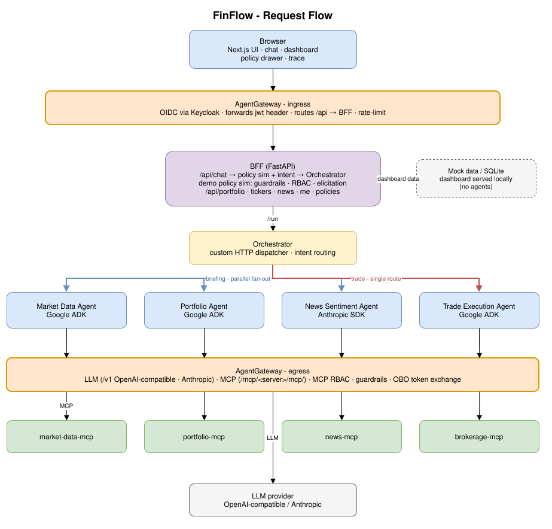
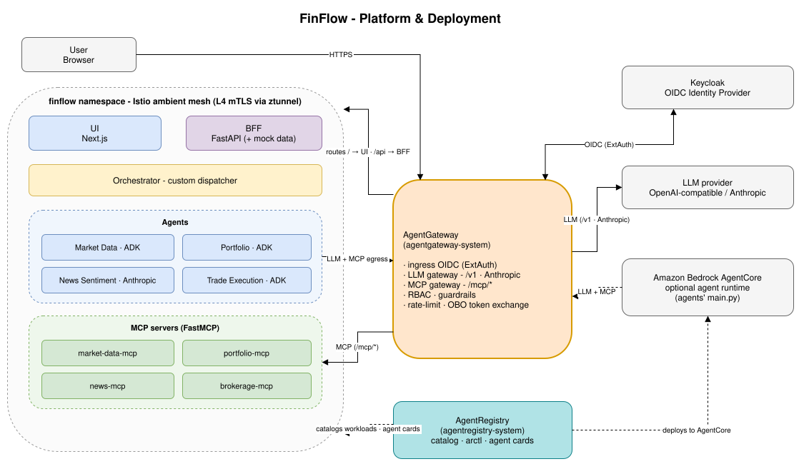

# FinFlow - Multi-Agent Portfolio Assistant

[](https://github.com/day0ops/finflow-demo/actions/workflows/ci.yml)
[](https://github.com/day0ops/finflow-demo/actions/workflows/release.yml)
[](LICENSE)

Multi-agent financial portfolio assistant demonstrating the Solo.io agentic product suite: agentgateway, agentregistry, and Istio ambient mesh.

## Architecture

FinFlow is a multi-agent portfolio assistant fronted by the Solo.io agentic suite.

Two views of the system:

### Request flow

A chat request travels from the browser through AgentGateway (ingress auth) to the BFF, then the Orchestrator. The Orchestrator fans a *briefing* out to three agents in parallel and routes a *trade* to a single agent. Every agent reaches its LLM and MCP tool server back out through AgentGateway. Dashboard data (portfolio, tickers, news) is served directly by the BFF from mock data and never touches the agents.



### Platform & deployment

AgentGateway is the single control point for north-south auth (OIDC via Keycloak), LLM egress, and MCP routing (RBAC, guardrails, OBO token exchange). AgentRegistry catalogs the agents and can deploy them to Amazon Bedrock AgentCore; Istio ambient provides mTLS inside the `finflow` namespace.



Each agent ships two entry points: `server.py` (FastAPI, for Kubernetes) and `main.py` (`BedrockAgentCoreApp`, for AgentCore). Frameworks: Market Data, Portfolio, and Trade Execution use Google ADK; News Sentiment uses the Anthropic SDK; the Orchestrator is a custom HTTP dispatcher.

## Repository Structure

| Directory | Description |
|---|---|
| `agents/` | Agent implementations (orchestrator, market-data, portfolio, news-sentiment, trade-execution) |
| `mcp-servers/` | FastMCP tool servers (market-data, portfolio, news, brokerage) |
| `bff/` | Backend-for-frontend (FastAPI) - proxies requests, handles auth |
| `ui/` | Next.js frontend |
| `infra/k8s/` | Kubernetes manifests (base + feature overlays) |
| `infra/agentregistry/` | AgentRegistry catalog and AgentCore deployment manifests |

## Prerequisites

- Python 3.12+, [uv](https://docs.astral.sh/uv/)
- [Bun](https://bun.sh/) 1.x
- Docker with Buildx
- kubectl

## Quick Start

```bash
# Run all tests
make test-all

# Build all images
make build REGISTRY=<your-registry>

# Deploy to Kubernetes
kubectl apply -k infra/k8s/base/
```

## Development

```bash
# MCP server tests
make test-mcp

# Agent tests
make test-agents

# BFF tests
make test-bff

# UI tests
make test-ui
```

## Release

Images are published to Google Artifact Registry on semver tags:

```bash
git tag v0.1.0
git push origin v0.1.0
```

Requires `WORKLOAD_IDENTITY_PROVIDER` and `SERVICE_ACCOUNT` repository secrets configured for Workload Identity Federation.

## License

[Apache 2.0](LICENSE)
